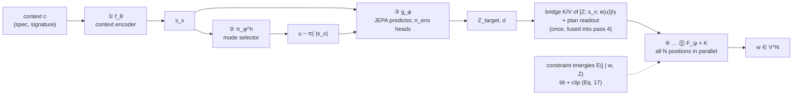

# text-VPA

**PR-JEPA for non-autoregressive code and text generation**: a JEPA planner decides the structure of a
program once, and a few-step discrete flow realizer writes all of its tokens in parallel, in K + 3
sequential network evaluations whatever the output length.

[](LICENSE)
[](https://doi.org/10.5281/zenodo.23498811)
[](https://www.python.org/)
[](https://pytorch.org)

This repository is the reference implementation of the preprint
*PR-JEPA: Decoupling Latent Planning from Few-Step Discrete Realization for Non-Autoregressive Generation
of Code, Legal Documents, and Control* (Yeonseok Lee, SLING AI Inc.,
[doi:10.5281/zenodo.23498811](https://doi.org/10.5281/zenodo.23498811); copy in
[`docs/pr_jepa_preprint.pdf`](docs/pr_jepa_preprint.pdf)). It extends the
[Vision-Predictor-Action](https://github.com/ylee-sling/Vision-Predictor-Action) framework from continuous
actions to discrete tokens.

## Status

> [!IMPORTANT]
> **A research prototype with equation-level verification. No trained checkpoints and no benchmark results
> yet.** The paper's evaluation protocol (Sec. 5) has not been run. What is verified:
> - 1,114 unit and integration tests check every equation against independent float64 references, the
>   K + 3 depth, Proposition 4(d), and the Stage-2 anti-leakage invariant;
> - the Pass@k harness passes every HumanEval reference solution (164/164) and 499/500 of MBPP's test split;
> - `scripts/gcp/train_l4.sh` (corpus → Stage 1 → Stage 2 → Pass@k) runs end to end and resumes after an
>   interruption (checked on CPU with tiny settings; not yet run on an L4);
> - the numerical checks of Sec. 4.6 reproduce Table 2 exactly (`python -m text_vpa.utils.verification`);
> - the roofline model reproduces every cell of Table 3 (`python -m text_vpa.utils.profiler --roofline`);
> - the full pipeline (Stage 1 → Stage 2 → Algorithm 1) runs end to end on CPU and with two-process DDP, and
>   a small model trained on two programs of the same canvas length writes, for each context, its own
>   program as valid Python (`pytest -m slow`).

## How it works



1. **Plan (passes 1–3, once).** The context encoder f_θ embeds the specification. The mode selector π_φ^h
   samples a discrete design mode u (control flow × library family), which resolves multimodality
   (Prop. 1). The JEPA predictor g_φ predicts the plan Z_target ∈ R^{M×d} over the program's structural slots
   (imports, signatures, class skeletons, declared identifiers, block headers), with an ensemble spread σ̄.
   It is trained against an EMA target encoder with VICReg (Eqs. 4–8).
2. **Bridge (once).** Keys and values of Z̃ = [Z_target; s_x; e(u)]/γ are computed once, with spectrally
   normalized projections, and reused at every realizer pass. Their memory is independent of N (Eq. 10).
3. **Realize (passes 4 … K + 3).** The FS-DFM realizer refines all N positions in parallel with the exact
   few-step jump kernel, tilted by constraint energies and clipped to remain valid (Eqs. 11–17, Algorithm 1).
   The Logit-KL realizer instead integrates straight lines in logit space (Eqs. 18–21).

`PRJEPASampler` audits at run time that a generation costs exactly K + 3 sequential network evaluations,
and that every parallel update keeps plan-admissible positions admissible (Prop. 4(d)).

## Installation

Python ≥ 3.10 (the exact pins of `requirements*.txt` need Python ≥ 3.12, because numpy 2.5 does). Install
PyTorch for your backend first ([pytorch.org](https://pytorch.org/get-started/locally/)): CUDA, ROCm, Apple MPS
and CPU are supported. Then:

```bash
git clone https://github.com/ylee-sling/text-VPA.git && cd text-VPA
python -m venv .venv && source .venv/bin/activate
pip install -r requirements-dev.txt      # exact verified versions (torch 2.14.1, transformers 5.21, tree-sitter 0.26)
pip install -e .                         # the text_vpa package (setup.py states minimum versions: torch >= 2.2)
python -m pytest                         # ~1 minute on CPU
```

## Quick start (CPU, synthetic data, about two minutes)

```bash
# Stage 1: planner pretraining (L_plan, EMA target encoder, stable-rank guard)
python train.py --stage 1 --data synthetic:512 --output-dir runs/s1 --max-steps 300 \
    planner=tiny realizer=tiny data=tiny data.tokenizer=bpe data.bpe_vocab_size=700 \
    training.batch_size=16 training.collapse_grace_steps=100000

# Stage 2: realizer + plan readout on the frozen planner's predicted plan
python train.py --stage 2 --planner-checkpoint runs/s1/stage1_final.pt --data synthetic:512 \
    --eval-data synthetic:64 --output-dir runs/s2 --max-steps 1000 realizer=tiny training.batch_size=16

# Algorithm 1 with K = 4
python generate.py --prompt "Write solve(a, b, c) that returns a * b + c." --k_steps 4 --realizer fs_dfm \
    --checkpoint runs/s2/best_stage2.pt
```

`generate.py` prints the generated text, the sampled mode u, the plan uncertainty σ̄, the audited depth
(K + 3) and a per-pass latency breakdown. The tiny synthetic run demonstrates the pipeline; it is not a model.

## Data

Records pair a context c (specification, docstring, signature) with a target program w₁.
`text_vpa.data.dataset` derives everything else from the target with tree-sitter (Python and C++/HLS-C):
- the structural view y: `[SLOT_<KIND>]` + slot text per slot, at most M slots;
- the design mode u;
- the plan-readout targets.

| Data spec | Source (local files, no network needed) |
|---|---|
| `synthetic:N` | built-in generator of specification → program pairs over 8 templates (tests, smoke runs) |
| `humaneval:PATH` | `HumanEval.jsonl(.gz)`: context = prompt, target = prompt + canonical solution |
| `mbpp:PATH` | MBPP JSONL: context = text + first test, target = code |
| `jsonl:PATH` | one `{"context": ..., "target": ..., "language": "python" \| "cpp"}` object per line; PATH may be a quoted glob (`'jsonl:data/corpus/train-*.jsonl.gz'`) |

Several specs can be combined: `--data humaneval:data/HumanEval.jsonl.gz jsonl:data/corpus.jsonl`.
- **Decontamination:** every training corpus must be deduplicated against the evaluation sets (Sec. 5.1);
  the corpus builder below does it.
- **Tokenizers:** `data.tokenizer=bpe` trains a byte-level BPE on the training corpus offline.
  `data.tokenizer=hf data.tokenizer_name=Qwen/Qwen2.5-Coder-1.5B` uses a pretrained one.
  `data.tokenizer=byte` uses raw bytes.

### Building a training corpus

`python -m text_vpa.data.corpus` turns permissively licensed Python into specification → function pairs:

```bash
python -m text_vpa.data.corpus download --dataset codeparrot/github-code-clean --config Python-all \
    --out data/raw --max-files 10                     # the Hub's Parquet conversion; resumable
python -m text_vpa.data.corpus build --source 'parquet:data/raw/*.parquet' \
    --humaneval data/eval/HumanEval.jsonl.gz --mbpp data/eval/mbpp.jsonl --out data/corpus
```

- **Sources:** `parquet:GLOB`, `jsonl:GLOB` (a `content`/`code` field and an optional license field) or
  `dir:PATH` (`*.py`, with `--assume-license`).
- **License:** only files whose license is permissive (MIT, Apache-2.0, BSD, ISC, ...) are used.
- **Pairs:** every top-level function with a docstring, a real body and no reference to anything except its
  parameters, locals, builtins and module-level imports. Context = the imports it uses + signature +
  docstring (HumanEval's prompt format); target = the imports + the whole function.
- **Deduplication:** exact, on the function's AST without its docstring.
- **Decontamination:** a function sharing any 13-word n-gram (identifiers and numbers; formatting ignored) with
  a HumanEval or MBPP problem is dropped.
- **Output:** `train-*.jsonl.gz` shards, `val.jsonl.gz` (0.5%, by hash) and `stats.json` with the count each
  filter removed. On the Python standard library it keeps about 8,000 functions from 18,000 files.

## Training (Sec. 5.1)

| Stage | Trains | Command |
|---|---|---|
| 1 | f_θ, π_φ^h, g_φ with L_plan; f_θ̄ by EMA only | `train.py --stage 1 --data … --output-dir runs/s1` |
| 2 | F_ψ (+ bridge) and the plan readout; **planner frozen**, conditioned on the predicted plan only | `train.py --stage 2 --planner-checkpoint runs/s1/stage1_final.pt …` |
| 3 (optional) | everything; planner at 0.1 × lr, VICReg on | `train.py --stage 3 --init-checkpoint runs/s2/best_stage2.pt --planner-checkpoint runs/s1/stage1_final.pt …` |

- **Collapse guard (Stage 1).** v(Z), c(Z), the stable rank and the eigenvalue range of the context and plan
  latents are logged every `training.collapse_check_every` steps. If srank(C) < d/2 after
  `training.collapse_grace_steps`, training stops and the checkpoint is saved as rejected; Stage 2 refuses it.
- **Anti-leakage (Stage 2).**
  - No target encoder exists in Stage 2.
  - The realizer accepts only a `PredictedPlan`.
  - The planner does not require gradients, is not in the optimizer, stays in eval mode, and its weights
    are re-checked by SHA-256.
- **Step budgets and plan dropout.** K is drawn from `realizer.step_budgets` (h = 1/K conditions the network)
  and t from the grid {k/K}. 10% plan dropout enables predictor-free guidance (`realizer.guidance_scale`).
- **Distributed training.** Data parallel with `torchrun --nproc_per_node=8 train.py …`: NCCL on CUDA/ROCm,
  Gloo otherwise.
- **Mixed precision and logging.** bf16 with `training.precision=bf16`. Weights & Biases with
  `--wandb-project NAME`; metrics are also written to `<output-dir>/metrics.jsonl`.
- **Checkpoints and resumption.** Checkpoints are self-contained (config, tokenizer, weights) and atomic.
  `--resume` continues the exact data stream (with `data.num_workers=0`); Stage 1 reuses the checkpoint's
  tokenizer.
- **One memory-limited GPU.** `training.<stage>.grad_accum_steps=k` makes one optimizer step from k
  micro-batches of `training.batch_size`; `training.activation_checkpointing=true` recomputes realizer blocks
  in the backward pass. Both leave the gradients unchanged (tested).
- **Large corpora.** `--build-workers N` tokenizes and parses in N processes. `--dataset-cache DIR` stores the
  built examples (int32 arrays, a few KB each), so Stage 2 and resumed runs load them instead of rebuilding.
- **Memory check.** `python -m text_vpa.utils.memory_probe planner=base realizer=l4 data=code training=l4` runs
  optimizer steps on worst-case batches and reports the peak GPU memory, the time per step and the projected
  wall time.

Configuration is a typed Pydantic schema composed by Hydra (`text_vpa/configs/conf`). Pass overrides as
trailing arguments, e.g. `planner=tiny realizer=logit_kl realizer.num_steps=4 training.batch_size=32`.
Unknown keys, wrong types and violated constraints fail at load time. Examples of the constraints:
1 ≤ K ≤ 8 with K among the trained budgets, 0 < ε < γ², c_max ∈ (0, 1], n_ens ≥ 2, m₀ ≤ m_end.
Defaults follow the paper:
- d = 256, M = 256, n_ens = 5;
- VICReg weights 25 : 25 : 1, γ = 1, ε = 10⁻⁴, m₀ = 0.996 → 1;
- d_r = 2048, L_r = 24, K ∈ {2, 4, 8};
- c_max = 1, T = 1, B = 64.

## Training on a GCP L4 VM

The `l4` presets fit one NVIDIA L4 (24 GB) with 64 GB of host memory (GCP `g2-standard-16`):
- the planner of the paper (42M parameters);
- a 325M-parameter realizer (d_r = 1024, 16 layers, N ≤ 512);
- a 32K BPE vocabulary;
- bf16, activation checkpointing, and micro-batches of 16 × 4 accumulation steps (B = 64).

```bash
# on your machine: create the VM (Deep Learning VM image, Ubuntu 24.04, NVIDIA driver 580)
ZONE=asia-northeast3-b scripts/gcp/create_vm.sh            # PROVISIONING=SPOT for a preemptible VM
gcloud compute ssh text-vpa-l4 --zone asia-northeast3-b

# on the VM
git clone https://github.com/ylee-sling/text-VPA.git && cd text-VPA
bash scripts/gcp/setup_vm.sh       # venv, pinned deps, GPU check, HumanEval/MBPP, harness check, tests
tmux new -s train 'bash scripts/gcp/train_l4.sh 2>&1 | tee -a train_l4.log'
```

`train_l4.sh` runs these steps in order:
1. download and build the corpus;
2. check memory on worst-case batches;
3. Stage 1 (50K steps);
4. Stage 2 (100K steps, validation loss every 2,000 steps);
5. Pass@k on HumanEval and MBPP.

Re-running the same command after a stop skips finished steps and resumes the interrupted stage from its last
checkpoint (every 1,000 steps). Use this after a Spot preemption. Set `GCS=gs://BUCKET/PATH` to copy `runs/` to
Cloud Storage every 30 minutes. Every setting is a variable at the top of the script.
- **GPU quota:** new projects usually need an L4 GPU quota increase in the region first.
- **Zone:** list zones with L4 GPUs with `gcloud compute accelerator-types list --filter=name=nvidia-l4`.

## Evaluation (Pass@k)

```bash
python evaluate.py --benchmark humaneval --data data/eval/HumanEval.jsonl.gz \
    --checkpoint runs/l4/stage2/best_stage2.pt --num-samples 10 --k 1 10 --out runs/eval/humaneval
python evaluate.py --benchmark mbpp --data data/eval/mbpp.jsonl --reference --out runs/eval/mbpp-reference
```

- **Sampling:** every problem gets n samples from Algorithm 1, with the context the training loaders build.
- **Programs run:**
  - HumanEval: prompt + sample + tests + `check(entry_point)`;
  - MBPP: setup + sample + asserts (test split 11–510 by default).
- **Execution:** each program runs in its own resource-limited process (CPU, memory, file size, timeout). This
  isolates crashes and hangs but is not a security sandbox, so run it on a disposable VM.
- **Score:** pass@k is the unbiased estimator of Chen et al. (2021).
- **Harness check:** `--reference` runs the canonical solutions. HumanEval passes 164/164 and MBPP 499/500;
  MBPP task 367's tests use an undefined class.

## Inference and profiling

```bash
python generate.py --prompt "def fibonacci(n: int) -> int:" --k_steps 4 --realizer fs_dfm \
    --checkpoint ./checkpoints/best_stage2.pt
python -m text_vpa.utils.profiler --roofline                                  # Table 3
python -m text_vpa.utils.profiler --checkpoint runs/s2/best_stage2.pt --lengths 64 256 --steps 1 2 4 8
```

The profiler times batch-1 generation for each K and compares it with a simulated autoregressive decoder:
same width and depth, with a KV cache, on the same device. Each run asserts the K + 3 depth.

## Equation-to-code map

| Paper | Code |
|---|---|
| Eq. 3, Eq. 8 (plan, σ̄) | `models/predictor.py`: `JEPAPredictor`, `ensemble_mean`, `ensemble_uncertainty` |
| Eq. 4 (EMA) | `models/ema.py`: `EMATargetEncoder`, `ema_momentum` |
| Eqs. 5–7 (L_plan, v(Z), c(Z)) | `engine/losses.py`: `PlanLoss`, `VICRegLoss`, `variance_hinge`, `covariance_penalty` |
| Thm. 1, Props. 2–3 | `engine/losses.py`: `theorem1_lambda_min_bound`, `stable_rank`, `calculate_stable_rank`; `tests/test_theory_verification.py` |
| Prop. 1 (modes) | `models/selector.py`, `data/ast_parser.py`: `ModeExtractor` |
| Eq. 10 (bridge) | `models/bridge.py`: `CrossAttentionBridge.precompute_kv`, `cross_attention` |
| Eqs. 11–12 (mixture path, L_real) | `models/realizers/paths.py`: `mixture_path_sample`; `fs_dfm.py`: `loss` |
| Eqs. 15–17, Prop. 4 (jump kernel) | `models/realizers/kernels.py`; `inference/energy_terms.py`: `check_parallel_update` |
| Eqs. 18–21, Lemma 2 (Logit-KL) | `models/realizers/logit_kl.py`, `paths.py` |
| Algorithm 1 | `inference/sampler.py`: `PRJEPASampler.sample`, `DepthAudit` |
| Sec. 3.3 energies | `inference/energy_terms.py` |
| Sec. 4.6, Table 2 | `utils/verification.py` |
| Sec. 5.4, Table 3, Eqs. 33–34 | `utils/profiler.py` |
| Sec. 5.1 (staged training) | `engine/trainer_stage1.py`, `engine/trainer_stage2.py`, `train.py` |

## Decisions where the paper is silent

These are recorded in [`CLAUDE.md`](CLAUDE.md). The most consequential:

- **Invariance normalization.** The prediction term is normalized per element (VICReg's MSE), so the
  published 25 : 25 : 1 weights keep VICReg's balance at every d. Eq. 5 sums the error over the d features;
  with weight 25 that over-weights it d-fold, and the plan's variance collapsed in Stage-1 runs.
  `vicreg.invariance_normalization=frobenius vicreg.lambda_invar=1` is Eq. 5 verbatim.
- **Plan readout.** The paper's "slot decoder" is `PlanReadout`, trained in Stage 2 on the predicted plan. It
  decodes slot kinds, signatures, a token inventory and the output length from Z_target, which is what the
  energies need at inference.
- **Energy terms.** Only identifier licensing is plan-mediated (and hard), so only it carries
  Prop. 4(d)'s guarantee under parallel updates. Grammar (hard), argument-count and type-annotation (soft)
  terms read the draft prefix. A network-free left-to-right repair enforces the hard ones at the end.
- **Repair of stalls.** A draft-dependent term evaluated on a noisy prefix can reject the token the posterior
  wants (for example [PAD] after a noise token that opened a bracket). The rejected mass becomes probability of
  staying (Prop. 4(b)), so after the last step such a position can still hold its source token. The repair
  treats these positions like a leftover [MASK]: it refills them with argmax p·e^(−E/T), where p is the last
  posterior and E is computed on the repaired prefix. `SampleResult.unrealized` counts them.
- **Canvas length.** Training canvases are the target plus [PAD], rounded up to `data.bucket_size`. The
  sampler takes N from the readout's length head by default, so the realizer may use N as a cue; a length
  that no training example had is out of distribution.
- **Stable-rank guard grace period.** The guard does not abort during a grace period, because random
  initializations are low-rank. The paper checks after each epoch.
- **Gradient accumulation.** Each micro-batch loss is scaled by 1/k. Two effects differ from one batch of k
  times the size:
  - VICReg's batch statistics are computed per micro-batch;
  - the spectral-norm power iteration on W_K, W_V advances once per micro-batch.
- **Decontamination.** A training function is dropped if it shares any 13-word n-gram with an evaluation
  problem, where words are identifiers and numbers (GPT-3's 13-gram rule). Punctuation is not counted, because
  a shared signature alone such as `(numbers: List[int]) -> List[int]` is not contamination.

## Repository layout

```
text-VPA/
├── text_vpa/
│   ├── configs/            Pydantic schema + Hydra YAML groups (planner, bridge, realizer, vicreg, training, data, readout, energy, sampler)
│   ├── models/             encoders, ema, selector, predictor, bridge, readout, plan, text_vpa_model, layers
│   │   └── realizers/      backbone (AdaLN), fs_dfm, logit_kl, kernels, paths
│   ├── data/               tokenization, ast_parser (tree-sitter), dataset, corpus (builder), synthetic
│   ├── engine/             losses, trainer_stage1, trainer_stage2, runtime
│   ├── inference/          sampler (Algorithm 1), energy_terms, loading
│   ├── evaluation/         pass@k, sandboxed execution, HumanEval / MBPP tasks
│   └── utils/              verification (App. B), profiler (Sec. 5.4), memory_probe, device
├── tests/                  equation-level tests, theory verification, end-to-end
├── train.py  generate.py  evaluate.py   CLIs
├── scripts/                init_repo.sh, release.sh; gcp/ (create_vm, setup_vm, train_l4)
└── docs/pr_jepa_preprint.pdf
```

## Citation

```bibtex
@misc{lee2026prjepa,
  author    = {Lee, Yeonseok},
  title     = {{PR-JEPA}: Decoupling Latent Planning from Few-Step Discrete Realization for
               Non-Autoregressive Generation of Code, Legal Documents, and Control},
  year      = {2026},
  publisher = {Zenodo},
  doi       = {10.5281/zenodo.23498811},
  url       = {https://doi.org/10.5281/zenodo.23498811},
  note      = {Preprint}
}
```

GitHub also reads [`CITATION.cff`](CITATION.cff). The VPA framework this builds on:
[doi:10.5281/zenodo.22960919](https://doi.org/10.5281/zenodo.22960919).

## License

GPL-3.0-only, as the VPA reference implementation. Copyright © 2026 SLING AI Inc.
